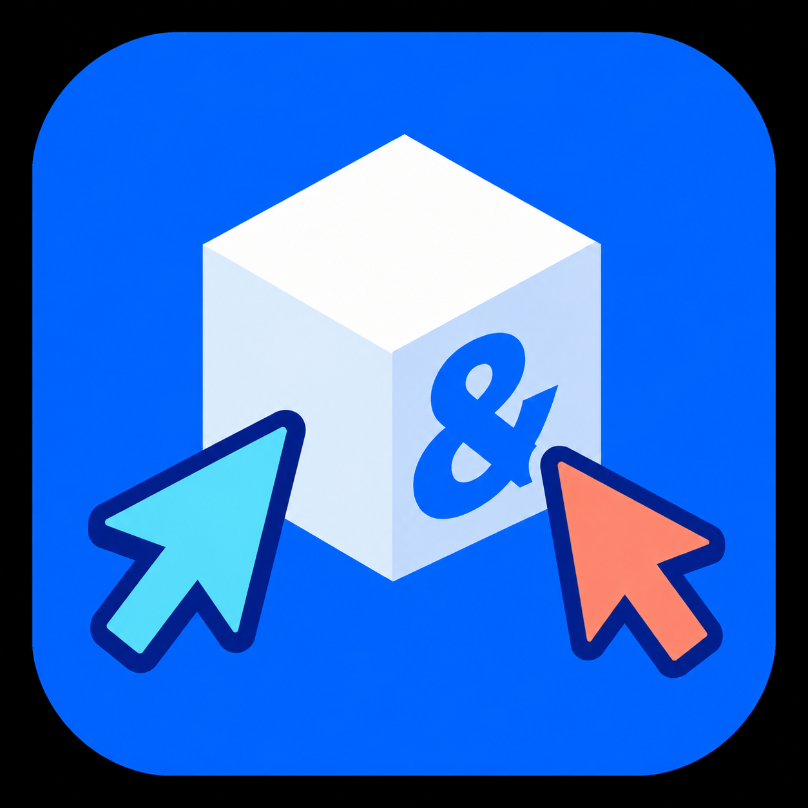

# s&box Editor Collaboration

A reusable **editor-only, experimental collaboration library**. It synchronizes live in-memory objects; it does not watch saved `.scene` files to replicate edits and does not use play-mode networking. Four working milestones are implemented: dock, connection, presence, and scene operations.

Read the limits below before using it on valuable work. This is not full Roblox Studio Team Create parity.

## Quick start

**Two friends, anywhere in the world, no server to run.**

1. **Install** the library into the project (Library Manager, or copy `Libraries/collaboration/`). Both of you open **the same project**.
2. **Host:** open the **Collaboration** dock and click **Host session**. The first time, the library writes `ProjectSettings/collaboration.json` for you (a fresh project id, every safety check on). You copy the code shown.
3. **Join:** your friend pastes the code and clicks **Join**.

That is the whole setup. The library carries a shared relay address, so a friend in Germany can join a host in Saudi Arabia without either of you opening a port, running a server, or editing a setting.

**Two things have to be true first**, and the dock's *Readiness* card (Setup tab) shows both:

- You are **Steam friends** and members of the **same s&box organization**.
- Your copies of the project are **identical** (the host refuses a friend whose files differ, and says so). Send the friend the project the first time, and after that share changes the way you normally do.

**No relay yet?** The Relay card on the dock's Setup tab says so and sets one up from inside the editor, with nothing to install and no need to close it: press **1. Open Cloudflare to create a token** (a free account is enough; the page opens with only the two permissions the relay needs already chosen), copy the token it shows, then press **2. Set up relay from the clipboard**. The relay is put on your own Cloudflare account, its address is remembered on this computer, and the token is used once, never saved, and removed from the clipboard afterwards. The library's maintainer can instead publish one shared relay inside the library (`RelayDefaults.DefaultUrl`), so that nobody has to do this. Until a relay exists, friends can join only on the same network or through a forwarded port.

**Want to try it alone first?** Use the **Try it alone** card (see [below](#try-it-alone-the-one-click-solo-test)).

## Install and join

1. Copy this entire `collaboration` directory into your project's `Libraries/` directory. Commit the library source to Git. Do not put it inside the project's game `Code/` folder.
2. Create `ProjectSettings/collaboration.json` once, commit it, and use that same file in every copy:

   ```json
   {
     "ProjectId": "2e9f8f81-8b38-4207-ad3e-4e7c0bea567f",
     "Org": "cyn",
     "LibraryIdent": "cyn.sbox_editor_collab",
     "LibraryVersion": "1.2.0",
     "RequireSteamFriend": true,
     "RequireOrgMember": true,
     "RequirePublished": true,
     "OrgMemberAllowlist": [],
     "RelayUrl": "wss://relay.example.com/relay"
   }
   ```

   The supplied testing project already has its own ID. For a different project, generate a new GUID once with `[guid]::NewGuid()` in PowerShell. `RelayUrl` is optional and is **not a secret** (see [Connecting across networks](#connecting-across-networks)); leave it out and the library uses only the local network and direct addresses. `Org`, `LibraryIdent` and `LibraryVersion` name the library this project expects; the three `Require*` switches and `OrgMemberAllowlist` decide who is admitted, and are described under [Admission gates](#admission-gates). A malformed field is dropped, keeps its safe default, and is reported by name in the readiness checklist rather than throwing.
3. Sync **source, source assets, scene files, `.meta` files, library files, project settings and the `.sbproj`** between developers. Use the same s&box installation version. No code or assets are transferred over the collaboration connection.
4. Restart the editor so s&box discovers the local library. Open **View → Collaboration**. The `[Dock("Editor", "Collaboration", "groups")]` registration also makes it available in the editor's dock menu.
5. Save/revert pre-existing local edits. Open a saved `.scene` under `Assets/scenes/`. Untitled scenes, prefab editors, and mounted scenes are outside the supported set. Play mode remains a visible fail-stop source-edit state unless the **Enable experimental runtime collaboration** dock option is explicitly turned on and a matching active runtime session is approved. Incoming `snapshot` and `accepted` packets are checked against the tracked target scene session before they reach the receive/apply path, so a queued packet for another playing source cannot bypass lifecycle admission. This option is off by default; it does not implement runtime transport, sampling, or apply.
6. Click **Host** in one editor. The dock publishes an **invite code** — copy it and send it to everyone you want in the session; the host also shows its public endpoint, the result of any UPnP port mapping, and any discovery failure on its status line. In the other editors paste the code into the invite field and click **Join**. A teammate on the same network needs no address of their own: the joiner searches the local network first (UDP **27846**), then the relay named in the code (if the project configures one), then the direct addresses carried inside the code, then the Advanced fields, first success winning. There is no name field: the collaborator's name is read from the signed-in Steam account. See [Identity and security](#identity-and-security) before connecting.

The collapsed **Advanced** section is a direct-addressing tool, not a codeless join path: the session key typed there must equal the host's session key, and a host started from **Host session** generates a fresh secret that is disclosed only inside the invite code — so a joiner without the code cannot authenticate against it by any route. In practice Advanced is for hosts started with a known key (the test harness in `Tools/`) and for reaching a host whose address is not carried in the code; for real sessions the invite code is the credential, and it already carries the address, port and secret. For two copies on one computer use `127.0.0.1`. For separate computers the host can bind `0.0.0.0`; allow the TCP session port through the host's firewall, and port-forward it for anyone outside the local network. There is no public matchmaking and no NAT hole punching, so a symmetric NAT may still fail — port-forward, or stay on one LAN or VPN. The host attempts UPnP port mapping (retrying a busy port) and a STUN public-endpoint report; both are best-effort, and a router that forbids UPnP or blocked UDP simply leaves the remote address for you to supply by hand. Sessions that share a transport key — one hosted from **Host session**, one joined by invite code, and one joined through discovery — are encrypted (see [Encryption](#encryption)); a session opened by typed address and key under **Advanced** is not, because that typed key is the handshake credential rather than a transport key; a peer's Steam identity is checked against s&box's auth service, and a peer that is not verified is refused unless the host allows unverified peers.

## Identity and security

> **Warning: session traffic is encrypted only when both peers run this library version — see [Encryption](#encryption). By default a peer is admitted only if s&box's auth service confirms its Steam account. If the host enables "Allow peers whose Steam identity could not be verified", a peer is also admitted when the service is simply unreachable — its SteamID is then self-asserted. Use this only on a network you trust.**

What this library actually does:

- **Identity comes from the signed-in Steam account**, read from `Sandbox.Utility.Steam`. That runtime read has been observed live in an open editor (`SteamId = 76561198964875726`, persona `live spontaneously`, no read error — recorded in [validation](docs/VALIDATION.md)). The persona name is **display only** and is never used as an identity. There is no name field; the user cannot type a name.
- The `teamcreate-4` `hello` packet carries the account ID, an identity token, the organization ident, the library version and the project manifest, and a Host/Join from the dock supplies them. Identity tokens are **single use**: every start requests a fresh one, and while that request is in flight the connect card shows the neutral line *"Preparing identity… waiting for a fresh Steam identity token; the session starts as soon as it arrives."* One automatic re-request is armed by the host's *"This peer's Steam identity token was rejected."* refusal; a second refusal is reported instead of retried. The identity service is unreliable in practice — a start has waited on that pending line for roughly a minute for one token, and verification has been seen to time out after about ten seconds — so a slow service shows up as waiting, not as an error, until it finally answers.
- **The handshake is fail-closed.** A peer whose `SteamId` or `SteamToken` is missing or malformed is refused before it can join. There is no anonymous-peer path.
- The host runs `SteamTokenRules.Decide` over the result of a token check and refuses a mismatched, malformed, missing, or rejected token **always**, regardless of any setting. The only outcome a setting may excuse is `ServiceUnavailable` — the check could not be performed, not that it passed.
- **The verification call is wired but has never been observed executing against the live service.** `SteamTokenHttpVerifier` posts to the documented endpoint through `Sandbox.Http` and requires HTTP 200, `Status == "ok"` and a matching account ID; every test in the suite runs against an injected fake transport, and no run has recorded a real verdict. Admission is deferred rather than blocking: a hello waits for the answer instead of stalling the editor's frame.
- Duplicate accounts are refused by comparing **canonical** SteamID forms, so one account cannot take two roster slots via leading zeros or a NUL suffix. This stops a duplicate; it does not establish that the account is who it says it is.
- The invite-derived session key is **retained and still required**. Identity answers *who*; the key answers *which project*. Key length alone is not a security boundary.

See [API evidence and known gaps](docs/API-AUDIT.md#security-posture-and-known-gaps) for the full list of what is not implemented, and [validation](docs/VALIDATION.md) for what was and was not actually exercised.

## Admission gates

Every gate is enforced **on the host**, over the `peerFacts` seam, before a peer reaches the roster; a refused peer is removed at once and its socket is closed on the next pump, so a refusal never occupies one of the 16 connection slots. The checks run in this exact order:

| # | Check | Refusal the joining peer sees | Config switch |
| --- | --- | --- | --- |
| 1 | Handshake shape and protocol | `Unsupported collaboration protocol version. This client requires protocol 4 (teamcreate-4).` Older libraries are named as such: `This peer runs an older collaboration library. Update the collaboration library on both machines and reconnect.` | none |
| 2 | Session key | `Incorrect session key` | none |
| 3 | Project identity | `Project ID differs. Use the same committed ProjectSettings/collaboration.json.` | none |
| 4 | Project/scene baseline | `Project/scene baseline differs (engine, source, assets or metadata). Sync copies in Git before joining.` | none |
| 5 | Collaborator name | `Invalid collaborator name` | none |
| 6 | Duplicate account | `That Steam account is already connected to this session.` | none |
| 7 | Steam identity | `The Steam identity service could not be reached, so this peer could not be verified. Enable "Allow unverified peers" to admit them anyway.` (and the specific missing / malformed / mismatched / rejected-token refusals) | `Allow unverified peers` may excuse **only** `ServiceUnavailable` |
| 8 | Steam friend | `<name> is not on your Steam friends list. Add them on Steam and reconnect.` | `RequireSteamFriend` |
| 9 | Organization membership | `<name> is not a member of the organization cyn.` | `RequireOrgMember`, with `OrgMemberAllowlist` as the roster fallback |
| 10 | Library version | `<name> runs collaboration library 1.0.0; this session requires 1.2.0. Update the library and reconnect.` | none — the requirement comes from `LibraryVersion` in the settings file, or the host's own version when the file pins none |
| 11 | Project manifest | `<name> has a different copy of this project (8-char hash vs 8-char hash). Sync the project (Git and Asset Party) before joining.` | none |

Two details matter more than the table:

- **The host's own loopback dial bypasses only the friend gate.** Hosting dials the host's own listener so the hosting editor takes part in the session it opened, and no account is a friend of itself; identity, organization, library and manifest are still evaluated for that hello exactly as for any other peer.
- **`RequirePublished` is a hosting gate, not a joining gate.** It is read by the readiness checklist: with it `true`, hosting is refused until the project is published to s&box (hidden or public), while a peer that cannot fetch the published package produces a warning row rather than a refusal.

**Disabling `RequireSteamFriend`, `RequireOrgMember` or `RequirePublished` weakens the admission design and must never be the shipped state of a project.** They exist so that a local experiment can run on one machine, not so that a session can be opened to strangers.

## Encryption

- **The session key is derived from the invite.** The invite code carries a secret; the 32-byte AES-256-GCM key is HKDF-SHA256 over that secret with the project id as its info (`Core/InviteCode.cs`).
- **Each connection gets its own key.** The dialing side opens with a plaintext preamble of the four bytes `TCS1` followed by a 16-byte random salt, then derives a per-connection key with HKDF-SHA256 (info `TeamCreate/v4-conn`) over the session key and that salt; the accepting side derives from the very bytes it read (`Core/Transport.cs`). A fresh salt per connection is what keeps a reconnect from ever sealing the same nonce twice.
- **Frames are AES-256-GCM.** A frame is `nonce || ciphertext || tag` — 28 bytes of overhead — and every nonce carries a four-byte direction tag (`CT-A` for the dialing side, `CT-B` for the accepting side), so both ends agree on one tag per stream without exchanging anything (`Core/AeadFraming.cs`).
- **A wrong key fails on both ends with a specific message.** A peer that cannot decrypt reports `Decryption failed. The invite code or session key does not match the host's.`; a peer that never spoke this protocol reports `The peer did not speak the collaboration encryption protocol (unexpected preamble).`
- **What is still not protected.** The 20-byte preamble (`TCS1` plus salt) travels in the clear; a replayed, reordered or dropped frame is **refused** (each end requires the exact next counter, see below), so a relay or network in the middle can end a session but cannot alter it; and **LAN discovery replies carry the session secret in the clear** on UDP 27846, so discovery assumes a trusted LAN. Use a trusted LAN or VPN when discovery is in play.
- **Both peers must run this library.** An older peer has no framing at all and is refused at the preamble; there is no downgrade to plaintext.

The roster identifies each collaborator and active scene. In the same scene, a colored camera marker shows position/facing and name; selected GameObjects receive colored bounding boxes and names. These are `Gizmo` draw calls, never saved GameObjects. Selections inside the inspector are represented by their selected GameObject only; independent component-selection presence is not implemented.

## Connecting across networks

The original design dialled the host's TCP port directly. That works on one LAN and when the host's router forwards the port; it fails for two friends at home, because the address in the invite is only what a STUN server saw, and nothing forwards that port. (A join to such a code fails with *"No connection could be made because the target machine actively refused it."*)

**The supported fix is a relay both editors dial out to.** Evaluated against the installed s&box build and current documentation:

| Option | Verdict |
| --- | --- |
| Direct TCP to the host | Kept as the LAN and last-resort route. Cannot be the only route. |
| s&box lobbies and `EditorUtility.Network` (`StartHosting`, `Connect`) | These host a **game** in play mode; they do not carry editor scene edits, and starting one enters play. Not usable for editing. |
| `sbox-server.exe` dedicated server | Also hosts a game, and still needs a reachable machine. |
| Steam Networking Sockets from editor code | No public managed surface. |
| **Outbound `Sandbox.WebSocket` to a relay** | Documented, needs no inbound port, works through NAT and CGNAT. **Chosen.** |

**Design.** The relay (`Tools/Relay`, ASP.NET Core, about 500 lines) pairs a host with its guests and forwards opaque bytes. The invite secret never reaches it: the room id and two proofs are one-way HKDF derivations of that secret, and the traffic is the same AES-256-GCM stream used for direct connections, opened end to end between the two editors. The relay therefore sees IP addresses, timing and sizes, not scene data, names, tokens or the key. A guest is admitted to a room only by presenting that room's proof; a host may additionally be required to present an access key. **The relay does not decide who may edit**: every guest that arrives through it still passes the host's admission gates (identity, Steam friend, organization, library version, project manifest).

Because a relay could otherwise replay, reorder or drop frames without breaking an authentication tag, each end of the stream now requires the **exact next frame counter** and refuses anything else (`Core/AeadFraming.cs`).

**Route order for a joiner:** LAN discovery, then the relay named in the code, then the direct addresses in the code, then Advanced. The dock shows which route carried the join (*"Connected through the relay (relay.example.com)"*, *"Connected on the local network"*), and when every route fails it lists each attempt with its reason and the next step, instead of a single raw socket error. A wrong invite secret is reported as terminal and is not retried; a dropped connection is retried by Recover & reconnect through the same list of routes.

**Setup: usually none.** The library uses its own shared relay address (`RelayDefaults.DefaultUrl`) unless a project names another in `RelayUrl` or sets it to `\"off\"`. The shared relay is a Cloudflare Worker (`Tools/RelayWorker`), deployed once with `npm run deploy`. To run your own instead, use the .NET relay (`Tools/Relay/README.md`) or deploy your own copy of the Worker, then: A relay you set up with the dock's button is used before the shared one and after one named in the project's settings; it is stored in `.collaboration/relay-url.txt`, which Git ignores, because the shared settings file is part of the project manifest and an address written there would make your project differ from your friend's. The invite code carries the relay's address, so the friend needs nothing.

1. Commit `"RelayUrl": "wss://your-relay-hostname/relay"` in `ProjectSettings/collaboration.json`.
2. On the **host's** machine only, put the relay's access key on one line in `.collaboration/relay-access-key.txt` (untracked; never commit it). Guests need nothing but the invite code.
3. Host. The Connect card shows *"Relay connected — friends can join from any network."* and the invite code now names the relay. If the relay is unreachable the card says so and the code is re-issued without it, so it never promises a route that will not work.

The engine's HTTP allow-list applies to WebSockets: the address must be a DNS name (not an IP, not a private range), and plain `ws://` is allowed only to loopback on ports 80, 443, 8080 and 8443. Use `wss://` for anything real.

## Presence in the scene

Each collaborator appears in the scene view as a floating blue sphere: three faint halo shells, a deep-blue body, two lit layers and a glint whose light always comes from the upper left of the viewer's screen, a slow bob, and a circular profile picture on a ring above it, then their name, and a status line (*Editing*, *Playing the game*, *Saving*, *Idle*, or what object they are editing). The sphere keeps a roughly constant size on screen, clamped so it is neither a speck across a large scene nor larger than the objects around it; labels fade with distance but never disappear. A collaborator who is playing gets a green ring, and their marker is meant to follow their **game camera**; that last behaviour is implemented but has not been seen with a real second editor (see [validation](docs/VALIDATION.md#2026-09-29--relay-presence-and-play-pause)).

The proportions, colours and distance behaviour are in `Core/PresenceStyle.cs` and are unit-tested; `Editor/PresenceMarker.cs` only turns those numbers into `Gizmo.Draw` calls. Nothing is created as a GameObject, so a marker can never be saved into a scene. It was inspected in a live editor with a synthetic collaborator (the profile picture is the signed-in account's own avatar), which is how two defects were found and fixed: the sphere was too small to read, and a backing disc drawn over the picture tinted it blue.

## Playing while a friend watches

**Not supported: a friend watching the running game from the editor.** Play mode in the s&box editor runs a *copy* of the scene in a separate game session. This library synchronizes the *source* scene, and there is no editor-side API that streams a running game's state into another editor (the lobby and dedicated-server APIs host a game for players, not for an editor to observe). Building that would mean a second replication system for runtime state, which is what the `Enable experimental runtime collaboration` option reserves and does not implement.

**What works instead, and is the closest practical workflow.** Pressing Play no longer ends the session. The player's editor keeps its connection, keeps sending presence, and pauses *source* synchronization for the duration:

- the player's outgoing scene sampling stops, so the game's own state changes are never reported as edits;
- scene changes arriving from the friend are **held in order** (up to 4096) and applied when play stops; the Connect card says *"Playing: scene edits are paused. N changes from collaborators will apply when you stop."*;
- the friend, still in the editor, sees the player's marker turn to **Playing the game** at the player's game camera, so they can follow where the player is and what they are looking at, and keep editing;
- if the buffer fills, synchronization stops with a message to stop play and use Recover & reconnect, rather than dropping a change silently;
- a hotload during play still fail-stops and archives recovery data.

The friend cannot see the game's objects move. For that, both people play the same build (the game's own networking, `Networking.CreateLobby`, is the supported path and is outside this library).

## Architecture

```
 Host editor                                        Guest editor
 ┌────────────────────────┐                          ┌────────────────────────┐
 │ CollaborationSession   │                          │ CollaborationSession   │
 │  SessionServer (gates, │                          │  Wire (AES-256-GCM,    │
 │   ordering, journal)   │                          │   strict frame counter)│
 │  RelayHost ──┐         │   wss (outbound only)    │  ┌── RelayGuest        │
 │  TCP listener│         │        ┌────────┐        │  │   TCP dial          │
 └──────────────┼─────────┘        │ Relay  │        └──┼─────────────────────┘
                └──────────────────►  rooms │◄───────────┘
                    direct TCP (LAN / forwarded port) ──────────────►
```

- `Editor/Core/` is engine-free and unit-tested by `Tools/CoreTests` (909 checks): `InviteCode`, `AeadFraming`, `Transport` (`Wire`), `RelayProtocol`, `RelayPipe`, `RelayLink`, `RouteFailureRules`, `PlaySpectate`, `PresenceStyle`, `TestHarnessRules`, `SoloScript`, `SoloBot`, `SoloCopy`, `SessionServer`, conflict and recovery rules.
- `Editor/` holds the parts that need the engine: `CollaborationSession`, `SandboxRelaySocket` (the only place `Sandbox.WebSocket` is used), `PresenceMarker`, the dock.
- `Tools/Relay` is the server; `Tools/RelayTests` runs the real relay, the real `Wire`, `RelayHost` and `RelayGuest` over loopback (44 checks, including replay, drop and tamper cases); `Tools/Relay/smoke.js` checks a running relay with an independent WebSocket client.
- The host is authoritative: it orders operations, journals them, and resolves simultaneous edits first-accepted-wins, so nothing is silently overwritten (see [Conflicts, undo and recovery](#conflicts-undo-and-recovery)).

## Production deployment

Checklist for handing this to real users:

1. **Deploy the relay** on a machine with a public DNS name and a real TLS certificate (Caddy in front of `Tools/Relay` is the shortest path; `Tools/Relay/README.md` has the config). Bind the relay to `127.0.0.1` when a proxy fronts it; set `RELAY_TRUST_FORWARDED_FOR=true` only then.
2. **Set `RELAY_ACCESS_KEYS`** to at least one long random key. With none, anyone who can reach the relay can open rooms; the relay warns at start.
3. Commit `RelayUrl`; keep the access key only on hosts, in `.collaboration/relay-access-key.txt`.
4. Leave `RequireSteamFriend`, `RequireOrgMember` and `RequirePublished` **on**, and leave *Allow peers whose Steam identity could not be verified* **off**.
5. Keep `VERSION`, `.version`, `LibraryInfo` and `ProjectSettings/collaboration.json` on the same number for every release, and publish the library package with the project so both friends run the same build.
6. Monitor `GET /health` (`{"status":"ok","rooms":N}`), restart on failure, and cap the process's memory and connections at the proxy. Logs never contain invite secrets, keys, tokens or scene data.
7. Before relying on it: run one session between **two different Steam accounts on two computers** across two home networks, including a join, a move, a property change, a save, a disconnect and a recovery. That has not been done (see [validation](docs/VALIDATION.md)).

## Try it alone: the one-click solo test

A full session normally needs two Steam accounts: the host refuses a second connection from the same account and asks Steam's service to confirm every guest. The solo test lets one person watch a complete session anyway.

**How to run it.** Any of three ways, all doing the same thing:

- **Collaboration dock → Try it alone → Run solo test.** In a real project this copies the project into a disposable folder, opens that copy in a second editor window, and the test starts there by itself about ten seconds after it loads.
- **Menu bar → Collaboration → Run solo test.**
- **`Tools/Run-SoloTest.ps1`** (add `-Relay ws://localhost:8080/relay` to test the relay too, `-Wait` to print the results, `-Stop` to end a running test, `-Manual` to open the copy without starting it). The script and the button share the same copy code (`Core/SoloCopy.cs`), so they cannot drift apart.

**What it does.** In the copy, your editor hosts a real session with your signed-in Steam account. A scripted collaborator, "Solo Test Guest", joins over the real encrypted transport, passes the host's normal project, baseline, library and manifest checks, and its floating blue sphere orbits your scene. The checklist in the dock then shows, live: its object appears in your scene; its move and property change appear as they happen; your move reaches it; undo reverses only your own move; a stale edit is refused rather than applied; pressing Play pauses scene edits and the collaborator's change waits until you stop; its delete appears; saving works with a collaborator connected; it leaves cleanly; a second collaborator joins and edits through the relay (when one is configured); and a wrong token or a different account is refused *because the token was rejected*. Then the collaborator keeps moving a cube around until you press **Stop**, which removes the cube and ends the session. The results are also written to `.collaboration/solo-report.json` in the copy.

**Why it is safe next to real work.**

- The test only runs inside a folder under `.collaboration/test-copies/` that also carries a marker file the copy step wrote. Both are checked (`TestHarnessRules`), and a real project never satisfies them.
- The one hole in admission (letting the host accept a reserved test identity, `76561202255233023`) exists only in that copy, is installed by the test runner alone, and needs a **random token generated for each run**. The reserved account number without that token is refused with *"This peer's Steam identity token was rejected."*, and so is any other account. This is asserted against a real host in the test suite and again live as the "opens nothing else" check.
- The copy carries no journals, outbox or recovery data from the real project, and a folder that already exists at the copy location with real files and no marker is never deleted.
- Your real project's scenes are never written to: the test only reads them to make the copy.

**What it proves and what it does not.** It proves that a full session works between this editor and a protocol-correct second participant: the host's admission checks, real-time sync in both directions, conflict refusal, per-user undo, Play pause and resume, saving, leave, and the relay path. It does **not** prove a second person's editor renders what yours does, that real friend/organization gates admit a real friend, or that anything works across two networks; the collaborator is a script, and the host treats the test identity as a friend and organization member inside the copy. For those, use two Steam accounts (see [Testing collaboration locally](#testing-collaboration-locally)).

**Requirements.** About 3 GB of available memory: the test opens a second editor, and the dock, menu and script refuse below that (the script accepts `-Force`). A saved scene under `Assets/scenes/`. To test the relay, run one (`Tools/Relay/README.md`) and pass `-Relay`, or set `RelayUrl` in the copy's settings.

## The Collaboration dock

**View → Collaboration** opens a header and three sections, chosen with a tab bar. Only what applies at the moment is shown, and the editor remembers the section you were last in.

The header is always visible: a state pill (a coloured dot and a verb), the organization badge, the library version, and one status line saying what the session is doing or why it stopped.

| Section | What is in it | When it is shown |
| --- | --- | --- |
| **Session** | **Connect**: **Host session** and, below it, the code field with **Join**; while hosting, the invite code with **Copy**, and **Leave** in place of Host. **Controls**: **Save synchronized scene**, **Undo my last collaboration operation**, **Recover & reconnect**, and the two preferences **Auto-save when idle** and **Automatic recovery** (both off by default). | Controls only during a session, or after one ended with an error or a recovery notice that has not been read. A line at the top says why hosting is blocked, with a pointer to Setup. |
| **People** | **This session**: the connected collaborators, their accounts and their scenes, with a button that takes you to where they are working. **Organization**: the members of your s&box organization, with who is online and who is in the session. | This session only during a session. |
| **Setup** | **Readiness**: Steam sign-in, active scene, project publication, library version and organization membership; only a blocked row stops hosting, and `ReadinessRules.BlockReason` is the sentence hosting refuses with. **Relay**: sets up the relay from the editor when none exists (see [Connecting across networks](#connecting-across-networks)). **Try it alone**: one button that runs the solo test (see [Try it alone](#try-it-alone-the-one-click-solo-test)). **About & limits**: a collapsed footer quoting the library's own limits. | Always. A person who cannot host yet is opened on Setup, and a solo test copy always opens on Setup, where its live checklist is. |

What each section shows, and which one opens first, is decided by `DockSectionRules` and `ConnectCopy` in `Editor/Core`, which have no engine dependency and are covered by the test suite. The tab bar is the engine's own `SegmentedControl`, the one its project-settings pages use, so it follows the editor's theme.

The dock is driven by probe commands in this workspace's validation; **no test has exercised its buttons, checkboxes and toggles by clicking them in a live editor.** Treat the interactive paths as reviewed code, not as observed behaviour.

### Keyboard shortcuts

| Chord | Identifier | Action |
| --- | --- | --- |
| `CTRL+ALT+S` | `collab.save` | Save synchronized scene |
| `CTRL+ALT+Z` | `collab.undo` | Undo my last collaboration operation |
| `CTRL+ALT+R` | `collab.recover` | Recover & reconnect |

They are registered on the Collaboration dock with `ShortcutType.Window`, so they work without the dock having focus, and they appear in **Preferences → Editor Keybinds** under *Collab* under exactly these identifiers. The editor owns `editor.save` (`CTRL+S`) and `editor.undo` (`CTRL+Z`) itself and wins that dispatch, so these chords deliberately sit on `CTRL+ALT` and take nothing native. Each handler runs the same guarded operation as its button through the same wrapper: a refusal the session raises is reported as a recorded session failure, never thrown into the editor's key dispatcher, and a handler whose guard refuses is a clean no-op plus that notice. The shortcut exists only while the Collaboration dock is open — the editor resolves it to an instance of the declaring widget.

## Exact edit support

Changes are sampled from the **live scene** at up to 20 Hz. Presence is sent at up to 10 Hz. These are sampling targets, not guaranteed latency: editor frame rate, scene size, journal flushes and network round-trip time affect delivery.

| Edit | Supported scope |
| --- | --- |
| Create / duplicate / paste | Ordinary GameObjects, retaining their GUIDs and component GUIDs. Empty objects and objects composed only of the component types below. Components must have scalar/null/empty-container serialized data, except ModelRenderer's four boolean `RenderOptions` fields. Embedded graphs, object-reference structures and nonempty collection data are rejected. |
| Delete | Objects/subtrees satisfying the same component restrictions. A multi-object change is accepted atomically or rejected as a whole. |
| Rename | `GameObject.Name` on ordinary non-prefab objects. |
| Reparent | Parent identity and local position/rotation/scale. Cycles and orphaned children are rejected. Moving across scenes is not supported. |
| Transform | `LocalPosition`, `LocalRotation`, `LocalScale` of ordinary non-prefab objects. Updates are streamed while changing; a final message closes the operation after the left mouse button is released. |
| GameObject inspector | `Name`, position/rotation/scale, `Enabled`, `Tags`. |
| ModelRenderer inspector | `Tint`. |
| CameraComponent inspector | `FieldOfView`, `BackgroundColor`, `Orthographic`, `OrthographicHeight`, `ZNear`, `ZFar`. |
| DirectionalLight inspector | `LightColor`, `SkyColor`, `Shadows`. |
| PointLight inspector | `LightColor`, `Radius`, `Shadows`. |
| BoxCollider inspector | `Center`, `Scale`, `IsTrigger`. |

The component types allowed on creation/deletion are exactly `Sandbox.ModelRenderer`, `Sandbox.CameraComponent`, `Sandbox.DirectionalLight`, `Sandbox.PointLight`, and `Sandbox.BoxCollider`, subject to the serialization restriction above. Transforming/renaming an existing ordinary object does not require all of its unchanged components to be in that list.

`Core/Protocol.cs` is the executable allowlist. Adding a component/property there is not sufficient to claim support: test serialization, application, identity, undo and reconnect against two editor processes first. See [validation](docs/VALIDATION.md) for what was actually exercised.

## Conflicts, undo and recovery

The host orders operations. Each operation contains the before/after states of the objects it touches. The **first accepted edit wins** when two operations started from the same object state; the other operation is rejected in full. Independent object edits merge. Editing different properties of the same object still conflicts. There are no object locks or silent last-writer overwrites.

Each accepted stream sample is journaled and acknowledged. During a drag, samples are grouped locally; the final message records one undoable gesture. A disconnect after some samples leaves the latest accepted sample on the host. The pending sample stays in the local outbox until acknowledged or explicitly rejected.

Use **Undo my last collaboration operation** (`CTRL+ALT+Z`). It submits a compensating operation and refuses if any affected object has changed since your edit. Remote edits do not enter your undo history. The library clears native undo history when subscribing, receiving a remote operation, or completing a local operation, and immediately re-seeds it with one entry named **Collaboration Undo**. The native **Undo** dock therefore lists that entry, and its Undo button and `CTRL+Z` act on your most recent collaboration operation — exactly what the Controls card's Undo button does. **Native Ctrl+Z is a supported collaborative workflow for the most recent operation only.**

The mirror is one row, not a history: each commit replaces it, so only the most recent operation is natively undoable at any moment, and a native tool's own entry made between commits sits in the same stack and can be what `CTRL+Z` reaches next. Redo is faithful rather than optimistic — it re-applies the change set captured when the row was seeded, and refuses with a notice when the scene has moved on or when the operation was never undone; it does not invent a second history where none exists. A refusal on this path is a dock notice, never a thrown exception, because the engine catches a throw from an undo entry and moves the row anyway, which would leave the two histories describing different work.

On a conflict, unsupported change, disconnect, timeout or application error, synchronization stops visibly. The live local scene is retained, and recovery JSON is written under `.collaboration/recovery/`. Click **Recover & reconnect** (`CTRL+ALT+R`) to archive the current local state, reload local disk scenes, retry any unacknowledged operation with the same ID, then apply the host's current state. This explicitly chooses the host state; it does not merge unsent offline work. Use the recovery file to inspect/reapply wanted changes afterward. If the disk copy itself contains unsupported changes, sync/revert that copy before recovery.

Recovery prompts by default. With **Automatic recovery** off — the default — a transient failure raises one toast, *Connection lost*, naming the Recover action and the chord, and then waits for a person. With the toggle on, the same session retries silently instead: at most three attempts, backing off at one second, four seconds and ten seconds, never overlapping because it reuses the single flight the button already queues. A silent retry only starts when the reconnect guard accepts it, no tracked scene holds unsaved local changes, and this editor is not the host; a fail-stop teardown, a policy refusal and a failure that never identified itself as transient are never retried. Spending the budget, or meeting one of those refusals, raises *Automatic recovery stopped* and leaves the Recover button exactly as it was.

The host retains state for other scenes, including scenes not currently open in every editor. A new subscriber gets an authoritative in-memory snapshot, then ordered operations. Duplicate receipts are ignored by operation ID. Presence updates the roster across scenes and is removed on connection loss (heartbeat timeout: 15 seconds).

## Saving and Git

Use **Save synchronized scene** (`CTRL+ALT+S`) after operations are acknowledged. The button refuses pending work. It calls the real editor session's `Save(false)`. The host's successful save also registers a compatible disk checkpoint, so clients with that exact saved project baseline can join; the original session-start baseline remains accepted. **Auto-save when idle** runs that same save unattended — once the scene has gone 30 seconds without a local edit, while no collaborator is reported editing and the editor is not in play mode, at most once every 30 seconds — and is off by default. Every save, however it started, is reconciled through `scene.saved` and reported in the controls card's save notice.

Native Save As, external file reloads and asset/source edits during a session are outside the supported workflow. Native Ctrl+S is absorbed rather than refused: a save this library did not initiate is reconciled through `scene.saved` by `SceneSaveRules.Decide`, accepted when the save guard holds, warned about when edits are still in flight, and ignored for scenes this session does not track. The supported action remains **Save synchronized scene**, and the engine's `scene.beforesave` event is still not a cancellable transaction, so this library cannot guarantee it will prevent a native save that has already begun. An observed scene-file timestamp change outside the library's Save still stops synchronization instead of treating it as a remote edit. Code hotload blocks the runtime lifecycle and must successfully archive recovery state before transport teardown and Leave can reset it. A pending connection is detached from frame promotion and disposed when it completes; recovery remains blocked if archive or teardown fails. Teardown failure is terminal for the current editor session: it remains visible, cannot be cleared by another begin or a no-connection completion, and never enables or reports hotload recovery. Leave enables deferred recovery only after a successful archive and completed teardown; ordinary Leave does not invoke hotload recovery. Runtime hotload data flow is unsupported. Complete source recovery, leave, sync source in Git, and start a new session before returning to play mode.

Commit:

- `Libraries/collaboration/` and `ProjectSettings/collaboration.json`.
- Project source, scene/source assets and their `.meta` files.

Ignore `.collaboration/`, `TestResults/`, generated assemblies, `obj/`, `bin/`, `.sbox/`, and compiled assets. The testing project's `.gitignore` includes these rules. When installing elsewhere, add `.collaboration/` to that project's ignore file.

The library stores acknowledged operations in the host's `.collaboration/journal-*.jsonl`, pending intent in `.collaboration/outbox/`, and explicit recovery snapshots in `.collaboration/recovery/`. These are local diagnostics/recovery data, not shared assets. Source/assets remain distributed through Git.

## Explicit limits

- No prefabs or prefab overrides, terrain/mesh editing, scene settings/metadata/navmesh editing, component addition/removal/reordering on existing objects, sibling reordering, arbitrary script properties, action graphs, resource edits, cross-scene moves, or hierarchy edits containing unsupported component data. Detected unsupported changes halt synchronization and preserve local state.
- No automatic rebase, offline edit merge, host migration, or automatic journal restoration after a process crash. Journals/outboxes remain available for manual recovery. Network reconnect to the same live host is supported; restarting the host starts a new session.
- Baselines are deliberately strict, including source and metadata bytes. Mixed partial saves or independently generated `.meta` files may require syncing/restarting. Save the desired host checkpoint before distributing it.
- The adapter scans/serializes scene objects; it does not have a universal public transaction hook for every editor action. Net changes between samples are synchronized. Transient actions completely undone between samples are not individual operations. Mouse-held unrelated edits may be grouped with a drag.
- Full-scene scanning, bounded 8 MiB packets, queues of 256 packets and a host limit of 16 connections suit small experimental sessions. Large scenes, high latency, large teams and long-running memory/journal growth have not been qualified.
- A collaborator's marker is a Gizmo drawn over the scene (it ignores depth on purpose), so it is visible through walls and is not part of any saved scene. Selection boxes are bounds, not rendered mesh outlines. Native mouse-drag interaction still needs human acceptance testing.
- Native undo history carries one collaboration row at most: every commit clears it and re-seeds a single **Collaboration Undo** entry, so only the most recent collaboration operation is natively undoable and there is no longer undo or redo trail behind it. A native tool's own entry made between commits shares that stack. Redo restores that same one operation and refuses once the scene has moved on.
- Unexpected custom component callbacks can have side effects even when their own properties are unchanged. Test a project's editor-time scripts before adopting collaboration.
- No NAT hole punching. **Without a configured relay, a friend on another network can join only if the host's router forwards the session port (or both sit on one LAN or VPN)**; UPnP and the STUN report are best-effort, and a STUN address that nothing forwards produces exactly the *"target machine actively refused it"* failure. The relay removes that requirement but has to be deployed (see [Connecting across networks](#connecting-across-networks) and `Tools/Relay/README.md`).
- The organization roster depends on the organization API returning a member list. A membership list that answers empty or hidden falls back to `OrgMemberAllowlist` in `ProjectSettings/collaboration.json`; that fallback has not been exercised, because the organization used here returns its single member.
- Avatars are fetched through the Steam avatar loader (`Texture.LoadAvatar`) and need the signed-in account. `Profile.Avatar` is a resource ident (`avatar:<steamid>`), not an HTTP URL, so it cannot be fetched directly.
- Transport encryption requires **both** peers to run this library version, and it covers only the framed session: the connection preamble is plaintext and discovery replies carry the session secret on the LAN (see [Encryption](#encryption)).
- Multi-peer visuals — nameplates, camera frustums, selection and focus indicators — have not been verified with a second editor, and no test has clicked the dock's controls in a live editor. Both are review-only evidence.
- Every connection test so far is on one machine, and the solo test drives a scripted collaborator, not a person. No run has used a second Steam account, a second computer, a public `wss://` relay behind TLS, a real router, or a home NAT, and the two-editor harness has not been re-run since protocol v4 (see [Testing collaboration locally](#testing-collaboration-locally)). What *has* been exercised live is listed in [validation](docs/VALIDATION.md#2026-09-29--relay-presence-and-play-pause).

## Development and tests

The enclosing testing workspace supplies `Tools/Compile`, `Tools/CoreTests`, a disposable two-copy test harness, and [API evidence](docs/API-AUDIT.md). None of the test probe code is part of this reusable library.

From the testing workspace with .NET 10 and s&box installed:

```powershell
dotnet build Tools/Compile/Compile.csproj
dotnet run --project Tools/CoreTests/CoreTests.csproj
./Tools/Prepare-EditorTests.ps1
./Tools/Run-EditorTests.ps1
```

Pass `-p:SboxRoot="D:\Steam\steamapps\common\sbox"` to the build and `-SboxRoot` to the preparation script for another installation path. The compile project builds the installed Base Editor Library as a project reference. The preparation script creates `.collaboration/test-copies/A` and `B`, copies identical fixture assets/metadata, then starts the editors sequentially. Close every s&box editor before running it; the current editor build redirects new launches while another editor is open. The test runner modifies only these disposable copies and writes `TestResults/editor-tests.json`.

Custom editor tools can group multi-frame edits with `CollaborationSession.Current.BeginContinuousEdit()` and dispose the returned scope when their drag ends. Built-in tools are observed through live state sampling and the editor's left-mouse state; no engine internals or reflection-based private API access are used.

Two files in this directory state the library's version and must stay in step with `LibraryInfo.LibraryVersion` in `Editor/Core/LibraryInfo.cs`: `VERSION` is the human-readable copy, and `.version` is the name the installed editor looks for — `/.version` is the literal string sitting next to `ReadVersionFromFile` in the installed `Sandbox.Tools.dll`, and the class that contains them is not in the editor source tree under `addons/tools/Code`, so the assembly was the only place to confirm it. The editor's library list reported `1.1.1` for this local copy before `.version` existed, so at least one other source of the number is in play for an unpackaged copy; `.version` is shipped so a packaged or Asset Party install has the file the editor expects. Bump all three together; a CoreTests check fails when `VERSION`, `.version`, `ProjectSettings/collaboration.json` and `LibraryInfo` disagree, or when any editor source restates the number as a literal.

## Testing collaboration locally

The two-editor harness in `Tools/` really does run two editors, and it has three requirements that are easy to miss:

1. **Close every s&box editor before `Prepare-EditorTests.ps1`.** This s&box build redirects a new launch while an editor is open, so the script checks for running `sbox-dev.exe` processes and exits with their PID and command line instead of timing out. It then copies `Collab_Library_Testing.sbproj`, the project's folders, the fixture scenes and their metadata into `.collaboration/test-copies/A` and `B`, installs `Tools/EditorProbe.cs` as each copy's `Editor/EditorProbe.cs`, and starts the two editors sequentially — a simultaneous start collides on the engine's shared `config/addons.json`.
2. **Two Steam accounts, or a deliberate, temporary weakening of the admission gates.** Both fixture editors sign in to the same Steam account on this machine, so the canonical duplicate-account rule (one account may not occupy two roster slots; it predates this overhaul) refuses the second editor, and with `RequireSteamFriend` on, self is not a friend of itself. The only way to run it here is to set `RequireSteamFriend` and `RequireOrgMember` to `false` in **both** copies' `ProjectSettings/collaboration.json` for the run — the host's own loopback dial already bypasses the friend gate, but the organization gate would still refuse a non-member. **That weakens admission to whatever can reach the port and must never ship that way:** restore both flags to `true` before committing. A second real Steam account is the honest alternative.
3. **The harness has not been re-run since protocol v4.** Its recorded 46-check run predates the `teamcreate-4` handshake, transport encryption, LAN discovery, the invite-code flow and the current dock, and the probe it drives has moved on since. `Prepare-EditorTests.ps1` installs the copy of `Tools/EditorProbe.cs` into both fixtures, and that copy is currently older than the project's live `Editor/EditorProbe.cs`, so refresh the two against each other before running it; otherwise the harness exercises an older probe contract than this documentation describes. Until that run happens, the harness results are historical evidence only — see [validation](docs/VALIDATION.md).

Neither `Tools/EditorProbe.cs` nor `Editor/EditorProbe.cs` is part of the shipped library; keep them out of any published package.
