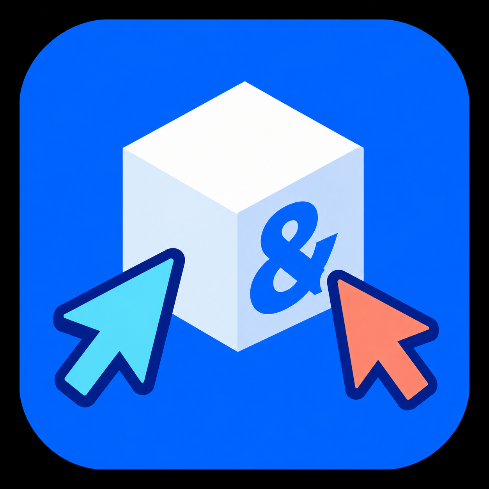

<p align="center">
  
</p>

<h1 align="center">s&amp;box Editor Collaboration</h1>

Real-time collaboration for the s&amp;box editor. One developer hosts a session and shares a join code; a friend opens the same project locally and joins with that code. Both then see each other in the scene as a floating sphere carrying a name and profile picture, and object moves and property changes appear live while they work.

## Install and join

1. **Install the library** into your project: copy `Libraries/collaboration/` into your project's `Libraries/` folder, or add it through the Library Manager once it is published.
2. **Host:** open the Collaboration dock and click **Host session**. The first run writes `ProjectSettings/collaboration.json` for the project; copy the join code it shows.
3. **Join:** your friend opens the same project and pastes the code into the dock's join field.

Two conditions must hold before a friend can join, and the dock's Readiness card shows both: you are Steam friends and members of the same s&amp;box organization, and your copies of the project are identical. Friends on different networks are connected through a relay; deploying the shared relay is covered in [PUBLISHING.md](PUBLISHING.md).

The full documentation - architecture, security, admission gates, conflict handling, the one-click solo test, and the validation record - is in [Libraries/collaboration/README.md](Libraries/collaboration/README.md).

## What is in this repository

| Path | Contents |
| --- | --- |
| `Libraries/collaboration/` | The library itself: the editor session, presence, dock UI, invite and relay protocol, plus its documentation. |
| `Tools/RelayWorker/` | The shared relay as a Cloudflare Worker, with its one-command deploy. |
| `Tools/Relay/` | An alternative self-hosted relay (ASP.NET Core) and its tests. |
| `Tools/CoreTests/`, `Tools/RelayTests/` | The test suites that gate every change. |
| `Tools/Compile/` | The editor compile gate. |
| `Tools/Run-SoloTest.ps1` | The one-click solo test: runs a full session against a disposable copy of your project. |

The test project this library is developed in is intentionally not part of the repository.

## Tests

```bash
dotnet run --project Tools/CoreTests/CoreTests.csproj     # engine-independent unit tests
dotnet build Tools/Compile/Compile.csproj -v q --nologo   # editor compile gate: 0 warnings, 0 errors
dotnet run --project Tools/RelayTests/RelayTests.csproj   # relay protocol tests
```

## Publishing

[PUBLISHING.md](PUBLISHING.md) is the checklist for releasing the library to s&amp;box: deploy the shared relay, run the gates, and upload the package with its icon (`Libraries/collaboration/docs/icon.png`).

## License

[MIT](LICENSE)
